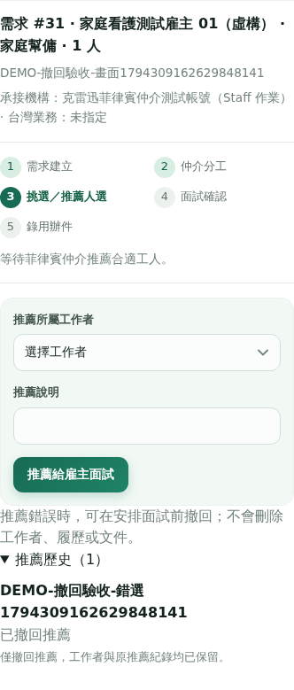

# REVIEW REPORT｜PR #12：B 流程整理與推薦撤回

本文件保留 PR #12 的歷史快照，#12 已合併。2026-11-11 main／wei 同步查核、最新一致性修正、85／26／15／20 測試結果與限制，請先看 [LINKED_RECORD_REVIEW.md](LINKED_RECORD_REVIEW.md)。後續均由最新 main 建 feature/fix branch，PR 回 main，不直接寫 main。

日期：2026-11-10。對象：合作開發者／PR reviewer。

PR：https://github.com/ccae3214/TK_SAAS_SALES_DEMO/pull/12

本文件是實作者的自我審查與實際驗證報告，不是另一位 reviewer 的獨立核准。精確候選 head、GitHub CI 與可合併狀態以 PR 為準；不得把本機測試通過當成正式資料或部署放行。

## 1. 審查結論

本輪已補上「推薦錯誤 → 撤回推薦 → 保留紀錄 → 改推其他工作者」流程；本機範圍驗收通過，可提交合作人 code review。沒有實體刪除工人、推薦列、履歷、文件或案件，沒有新增 schema／migration、沒有變更 secrets，也沒有部署或合併 main。

已整合本輪凍結的 main `e0e5a71`；原 PR 的仲介目錄、工作起點、新會員指引與 main 雇主直接選工等功能保留。若 main 之後再更新，須另核對差異，不把這次結果外推到未測基底。

## 2. 使用者已確認的規則

| 情況 | 結果 |
| --- | --- |
| 有效菲律賓仲介、推薦及工人都屬其機構、仲介來源、需求 open、尚未安排面試／未連案件 | 可撤回 |
| 同一機構其他有效承辦人 | 仍以機構歸屬判定，不限定原按鈕操作者本人 |
| 已安排面試、已有面試日期、已錄用／連案件、需求取消或額滿 | 拒絕撤回 |
| 雇主自行挑選的人選 | 菲律賓仲介不可代為撤回 |
| 其他機構的人選 | 404，不暴露目標是否存在 |
| 雇主、台灣仲介、工作者、管理者呼叫本撤回 action | 403；本輪不新增管理者代撤回權限 |
| 匿名／錯誤 Origin | 沿用既有認證／Origin 保護，401／403 |
| 對已撤回的同一推薦重送 | 200、alreadyWithdrawn=true，不追加重複歷史 |

撤回不是「雇主拒絕」、不是「刪除工人」、也不是「取消已安排的面試」。

## 3. 程式變更導讀

| 路徑 | reviewer 應檢查的內容 |
| --- | --- |
| `src/lib/hr-candidate-withdrawal.js` | 純狀態判斷、撤回標記與顯示文字，不授權資料讀取 |
| `src/lib/hr-candidate-withdrawal-store.js` | 伺服器交易、機構／來源檢查、candidate＋order 鎖定、狀態更新、冪等與 rollback／release |
| `src/app/api/hr/route.js` | PATCH `job-order-candidate-withdraw`；GET 來源旗標；推薦說明保留標記防護；舊推薦 UPSERT 及雇主面試更新不能覆寫／復活撤回紀錄 |
| `src/components/HrRecommendationHistory.jsx` | 確認前可取消、撤回中禁用、推薦歷史、結束需求 readonly |
| `src/components/HrMemberPortal.jsx` | 菲律賓操作、雇主／台灣狀態同步、終止人選從推薦選項移除、關閉需求仍可看歷史 |
| `src/components/HrManagement.jsx` | 桌面／手機管理清單顯示「已撤回推薦」，不誤標為雇主未錄用 |
| `src/lib/hr-translations.jsx` | 新增中英靜態字串；未宣稱完整英文／Filipino 實機驗收 |
| `tests/hr-candidate-withdrawal.test.mjs` | 20 項純函式／交易替身測試 |
| `scripts/verify-recommendation-withdrawal.py` | 真實隔離 PostgreSQL、實際登入 UI、授權拒絕、資料保留、競爭測試 |

既有 B 範圍導讀與環境：`PROJECT_MAP.md`、`LOCAL_REVIEW.md`；完整歷史：`TASK_LOG.md`、`VERIFICATION_REPORT.md`。

## 4. 資料與交易取捨

沒有擅加 `withdrawn` DB enum 或新欄位。沿用既有 `status='rejected'` 作終止狀態，在原 `notes` 後附伺服器寫入的 `[agency-withdrawal]` 事件，內容為時間與操作者 member ID。前端透過共用 helper 顯示「已撤回推薦」，原推薦說明不覆蓋。

- 這是相容既有 schema 的表達方式，不是防竄改的完整事件稽核系統。
- 新推薦寫入既有 proposed_by；GET 計算是否為仲介來源，撤回交易仍從 DB 重新檢查，不能相信客戶端旗標。
- 舊版菲律賓推薦的 proposed_by=NULL 仍相容；以 route／worker 的機構歸屬檢查。若正式匯入資料曾把雇主選工來源也清成 NULL，需先校對來源，不能直接套用這個相容假設。
- 撤回與面試更新都鎖住 candidate／order；先取得鎖且狀態符合者成功。若先撤回，雇主的過時頁面不能再安排／錄用；若先排面試，撤回回 409。
- 推薦 UPSERT 不更新終止人選，避免把撤回標記洗掉。保留 `(route_id,worker_id)` 唯一限制；同一 route 下不提供「重新啟用同一筆已撤回人選」，可改推其他工作者。重新開啟推薦屬另一個需確認的流程，沒有偷偷加入。
- 工人、文件與履歷不寫入撤回交易；案件／需求不刪除。

## 5. 實際驗證與證據

### Node 與建置

【WSL】

    node --test tests/hr-candidate-withdrawal.test.mjs tests/hr-workflow.test.mjs scripts/test-hr-requirements.mjs
    node --check src/lib/hr-candidate-withdrawal.js
    node --check src/lib/hr-candidate-withdrawal-store.js
    docker compose --env-file .env.review.local -f compose.review.yaml build app
    docker compose --env-file .env.review.local -f compose.review.yaml up -d --no-deps --force-recreate app
    git diff --check

- Node：55 通過、0 失敗、0 跳過（本輪 20＋既有 35）。交易替身測試不冒充 PostgreSQL 整合測試。
- Docker build 成功，app 僅重建自身，資料庫／volume 保留；已讀回容器與 build image 一致：`sha256:5f2011d1d02768616decfc21d0ee1b0f363cdd1817212515d711dc47bb65dcbf`。
- 語法與 diff 檢查通過。build 既有設定跳過 lint／型別；不能算通過。Browserslist 過時警告仍在。

### 真實本機瀏覽器＋PostgreSQL

【WSL】

    <playwright-python> scripts/verify-recommendation-withdrawal.py
    <playwright-python> scripts/verify-local-review.py

`<playwright-python>` 是已安裝 Playwright／Chromium 的獨立 Python 環境；不是要求在 Windows 執行程式。腳本限定 localhost:8088、核對 Docker project 與隔離 DB，會新增虛構 fixtures，不可指向正式 DB。

- 撤回專項：15 通過、0 失敗、pageerror=0。
- 既有 B／main 回歸：26 通過、0 失敗、pageerror=0；兩條 UI 配對、會員與文件頁等仍通過。

| 專項驗收 | 實際結果 |
| --- | --- |
| 菲律賓 UI 推薦→取消撤回確認 | 推薦維持 proposed |
| 確認撤回、原說明＋事件保留 | rejected＋withdrawal 事件，同一推薦列仍存在 |
| 工人／文件逐筆 JSON 比較 | 撤回前後一致，該工人無新案件 |
| 重送撤回 | 200、歷史不重複追加 |
| 過時推薦說明更新 | 被拒絕，不能覆寫撤回事件 |
| 過時雇主頁面 scheduled／passed／rejected | 409，不能復活 |
| 雇主重整與菲律賓重整 | 可見撤回、沒有該筆面試／撤回操作 |
| 改推別人→安排面試 | 正常；此時再撤回 409、資料不變 |
| 錄用後撤回 | 409、原案件保留 |
| 雇主直接挑選後由菲律賓撤回 | 409 |
| 跨機構目標（獨立 fixture） | 404，原狀態不變 |
| 並行 HTTP 撤回 vs 排面試 | 一個 200、一個 409，最終狀態一致 |
| 需求額滿後歷史 | 仍看得到撤回紀錄，沒有撤回按鈕 |
| 390px 畫面 | document 無水平溢出；窄版截圖文字完整 |

畫面證據：

這是 Chromium 390px 寬度的真實 UI 截圖，不是 iPhone 實機。擷取時加高 viewport，讓卡片置於真實 sticky 導覽下方；沒有隱藏產品控制或重繪截圖。

### 失敗紀錄（沒有省略失敗）

1. 舊運行 image 實際執行新專項，停在「找不到撤回按鈕」，重現使用者回報；此輪 0 項完成、1 次中止，不冒稱舊版已通過。
2. 新版首次專項在原說明比對失敗：測試經 UI 推薦時忘記填說明，卻斷言應有預設文字。補上 UI 輸入，未移除資料保留斷言。
3. 最終 image 重建後，完整重跑專項 15 項、既有 26 項及 Node 55 項均通過；不沿用舊 image 的成功結果。

## 6. 合作人手動複驗

【Windows】瀏覽器開啟 http://localhost:8088/hr/login 。測試帳號與密碼讀取方式只看 LOCAL_REVIEW.md，密碼不要貼 PR。

1. 菲律賓測試帳號 →「需求與配對」，找到一筆 open 需求及尚未面試的仲介推薦（例如原 `DEMO-手動推薦驗收`，實際狀態以畫面為準）。
2. 按「撤回推薦」→先取消，確認推薦未變；再按一次並確認。
3. 確認出現在「推薦歷史／已撤回推薦」、重整後仍在、工人與文件仍可查，該人選不再列為此 route 可重推的終止人選。
4. 用雇主帳號重整同一需求，不能再安排／錄用該已撤回人選。
5. 菲律賓改推其他可用工作者；雇主安排面試後，菲律賓不能撤回。已錄用也不能撤回。
6. 原生確認視窗沿用現有中文互動；本輪沒有宣稱完整英文原生視窗或 Filipino 校對通過。

不要刪現有案件來製造可推薦人選；用隔離 fixture。不同角色先登出或使用獨立瀏覽器 profile，普通分頁共用 cookie。

## 7. Reviewer 特別注意與未驗部分

- 本輪自我審查已針對來源混淆、跨機構、過時寫入、冪等及面試競爭補上檢查；沒有發現這次已授權驗收範圍內尚未修復的可重現阻擋。但這不是全專案安全稽核或獨立 code review。
- 需人工確認：schema 相容表達是否符合團隊長期資料模型；NULL 來源的歷史資料假設；是否另需明確的重新推薦／已安排面試取消政策。
- 單次並行互斥測試不是壓力測試，不代表所有 DB 鎖順序／斷線／重試組合都已測完。
- 未驗：真實 LINE／Google／Push、iPhone／LINE WebView、完整多機構權限矩陣、Filipino、真實文件上下載與附件歷史遷移、正式備份還原、新環境冷初始化、無障礙完整審核。
- 新程式不要求 schema migration；但原 main 的初始化／migration 路徑仍存在，不能將登入 GET 當成絕對唯讀。
- 不可直接用舊寫入 API 回退服務而忽略撤回資料：舊版可能只顯示 rejected，且缺少防復活保護。若需回退，應先停止推薦／面試寫入或保留本輪 guard，不自動覆蓋 DB、也不刪撤回事件。
- 只更新 PR，不合併 main、不部署。main 的 self-hosted Deploy workflow 可能於合併後自動部署，須另取得批准。

GitHub CI 的精確 head 結果附在 PR 說明；本報告不預填尚未完成的 CI 成功，也不因為文件更新導致 commit 改變而保留過時 head 宣稱。
